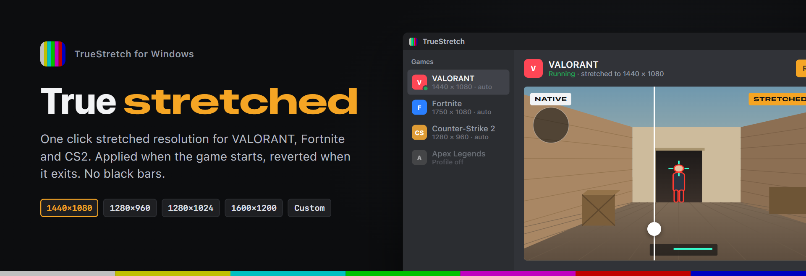
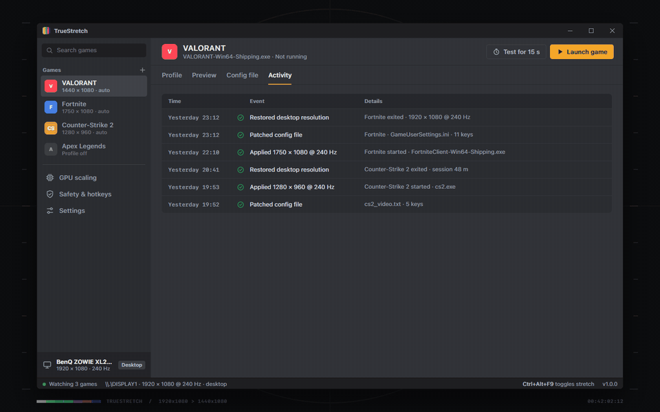
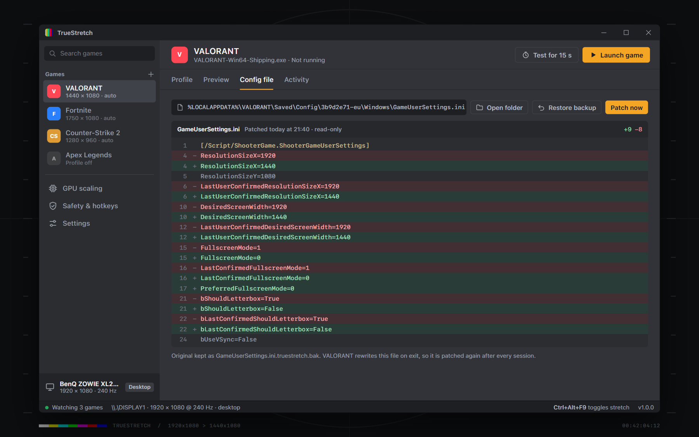
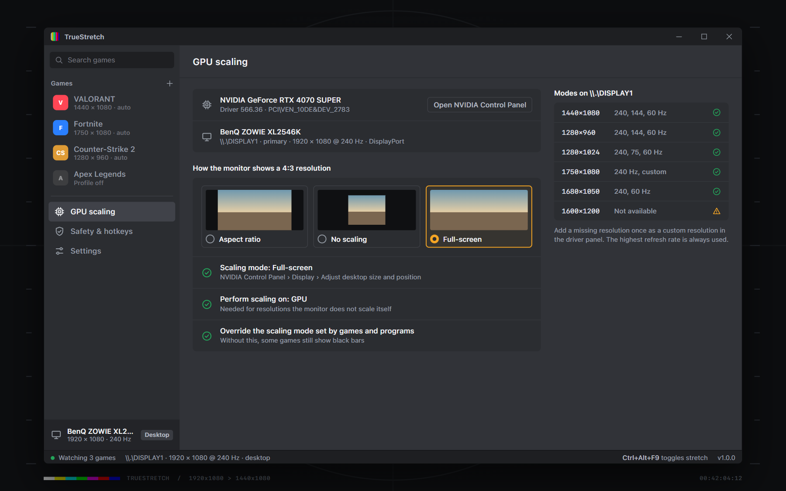
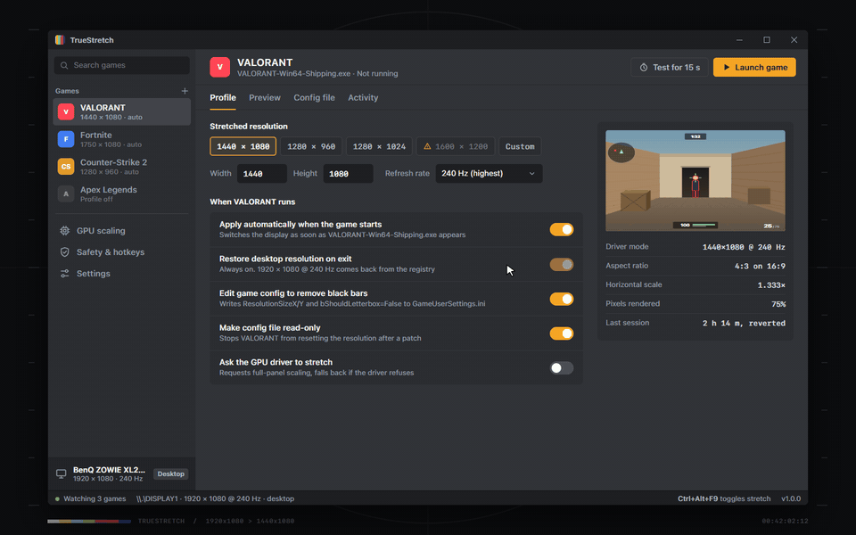
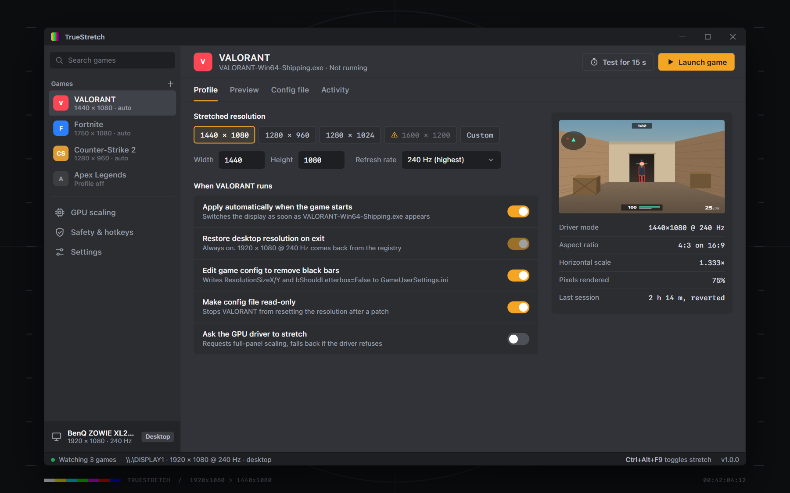
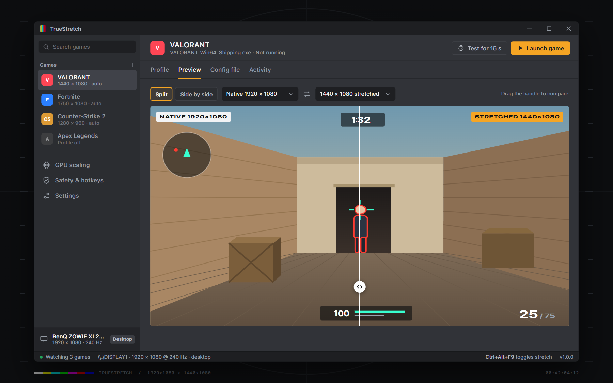
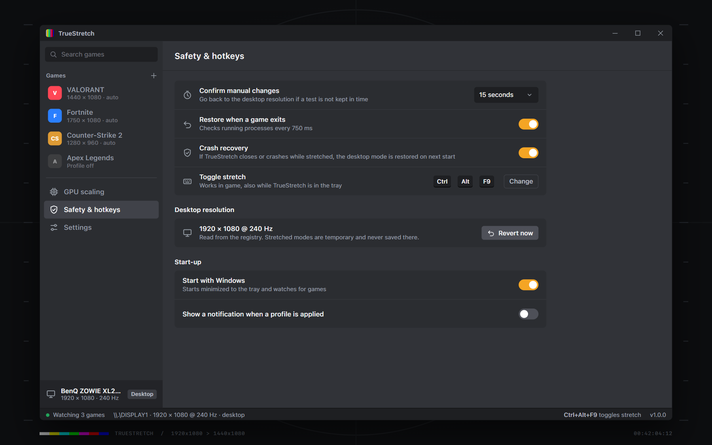

<div align="center">



**One-click true stretched resolution for VALORANT, Fortnite and Counter-Strike 2. Applied when the game starts, reverted when it exits.**

<a href="../../releases/latest" class="download-btn-action"></a>


</div>

TrueStretch is a small Windows app that gives you **true stretched resolution** in VALORANT, Fortnite and CS2 without touching the NVIDIA Control Panel every time you play. Pick **1440x1080**, 1280x960, 1280x1024, 1600x1200 or any custom resolution per game: TrueStretch switches your monitor when the game process starts, edits the game's own config so it renders full screen instead of with black bars, and puts your desktop resolution back the moment you quit.

<p align="center"></p>

## Why TrueStretch

### Per-game profiles that apply themselves

Every game gets its own stretched resolution. TrueStretch watches running processes (`VALORANT-Win64-Shipping.exe`, `FortniteClient-Win64-Shipping.exe`, `cs2.exe`, `r5apex.exe`) and switches the display the instant one starts. When it exits, your 1920x1080 desktop comes back. No more alt-tabbing into a stretched, blurry Windows desktop.

<p align="center"></p>

### True stretched, not black bars

Changing the Windows resolution alone often gives you a 4:3 picture with black bars. TrueStretch also patches the game's settings file: `ResolutionSizeX/Y`, `LastUserConfirmedResolutionSizeX/Y`, `FullscreenMode=0` and `bShouldLetterbox=False` in VALORANT's and Fortnite's `GameUserSettings.ini`, and `setting.defaultres`, `setting.aspectratiomode` in CS2's `cs2_video.txt`. A backup is written first and the file can be locked read-only so the game does not reset it.

<p align="center"></p>

### GPU scaling helper

Black bars that survive a correct config are almost always a scaling setting. TrueStretch detects your NVIDIA, AMD or Intel GPU, shows exactly where "Full-screen" scaling lives in your driver panel, asks the driver for full-panel stretch when it applies a mode, and lists which stretched resolutions your monitor actually exposes.

<p align="center"></p>

### A safety net you can trust

Manual changes are validated with `CDS_TEST` first and applied with `CDS_FULLSCREEN`, so they are never saved to the registry. If you do not press **Keep changes** within 15 seconds, the desktop mode comes back on its own. If TrueStretch crashes or is killed while stretched, a crash watchdog restores your resolution on the next start.

<p align="center"></p>

### Hotkey and live preview

Press **Ctrl + Alt + F9** to toggle stretch in game. The Preview tab shows how models and the crosshair change at your chosen resolution before you commit to it.

### Compared with the usual way

| | TrueStretch | NVIDIA / AMD panel by hand | Windows display settings |
|---|:---:|:---:|:---:|
| Applies automatically when the game starts | Yes | No | No |
| Restores desktop resolution on exit | Yes | No | No |
| Edits VALORANT / Fortnite / CS2 config (no black bars) | Yes | No | No |
| Locks config so the game cannot reset it | Yes | No | No |
| 15-second auto revert on manual changes | Yes | No | Yes |
| Crash recovery | Yes | No | No |
| Global hotkey toggle | Yes | No | No |
| Per-game resolution profiles | Yes | No | No |

## Screenshots

| | |
|---|---|
|  |  |
|  |  |

## Quick start

1. Download `TrueStretch-v1.0.0-win-x64.zip` from <a href="../../releases/latest" class="download-btn-action">Releases</a>.
2. Unzip anywhere and run `TrueStretch.exe`. It is portable: no installer, no admin rights.
3. Pick a game in the sidebar, choose a resolution (1440x1080 is the classic VALORANT stretched res), press **Test for 15 s**, then **Keep changes**.
4. Launch the game. That is it.

If your resolution shows **Not available**, add it once as a custom resolution in NVIDIA Control Panel, AMD Software or Intel Graphics Command Center, then restart TrueStretch.

Settings are stored in `%APPDATA%\TrueStretch\settings.json`.

## Supported games

| Game | Detected process | Config TrueStretch edits |
|---|---|---|
| VALORANT | `VALORANT-Win64-Shipping.exe` | `%LOCALAPPDATA%\VALORANT\Saved\Config\<account>\Windows\GameUserSettings.ini` |
| Fortnite | `FortniteClient-Win64-Shipping.exe` | `%LOCALAPPDATA%\FortniteGame\Saved\Config\WindowsClient\GameUserSettings.ini` |
| Counter-Strike 2 | `cs2.exe` | `<Steam>\userdata\<id>\730\local\cfg\cs2_video.txt` (Steam path read from the registry) |
| Apex Legends | `r5apex.exe` | `%USERPROFILE%\Saved Games\Respawn\Apex\local\videoconfig.txt` |

Works with NVIDIA GeForce, AMD Radeon and Intel Arc / Iris graphics on Windows 10 and Windows 11, on any monitor that accepts the mode (BenQ ZOWIE, ASUS ROG, Alienware, AOC, LG UltraGear and so on).

## FAQ

**How do I get true stretched resolution in VALORANT without black bars?**
Set the profile to 1440x1080, keep "Edit game config to remove black bars" on, and make sure GPU scaling is set to Full-screen (the GPU scaling page shows where). TrueStretch writes `bShouldLetterbox=False` and the matching resolution keys, then switches the display when VALORANT starts.

**Why does Fortnite keep resetting my stretched res?**
Fortnite rewrites `GameUserSettings.ini` when it closes. Turn on "Make config file read-only"; TrueStretch also patches the file again after every session.

**How do I play CS2 stretched 4:3?**
Choose 1280x960 or 1440x1080 for Counter-Strike 2. TrueStretch sets `setting.aspectratiomode` to 4:3 in `cs2_video.txt` and shows the launch options (`-fullscreen -w 1280 -h 960`) to paste into Steam.

**I still see black bars. What is wrong?**
That is the GPU scaling mode. In NVIDIA Control Panel set Scaling mode to Full-screen, Perform scaling on GPU, and tick Override the scaling mode set by games and programs. On AMD turn on GPU Scaling with Full panel; on Intel choose Stretch.

**Can a stretched resolution get stuck on my desktop?**
No. Modes are applied with `CDS_FULLSCREEN` and never written to the registry. Manual changes revert after 15 seconds unless kept, the desktop mode is restored when the game exits, and a crash marker repairs it on the next start.

**Is TrueStretch bannable? Does it touch the game?**
It does not inject, read or modify game memory. It changes the Windows display mode and edits the game's own settings file, exactly what you would do by hand. Use it at your own risk and follow each game's terms.

**Which stretched resolution is best?**
1440x1080 keeps full vertical resolution and is the most popular VALORANT stretched res. 1280x960 is the CS2 classic and gives higher FPS. 1280x1024 (5:4) stretches models a little more.

## Build from source

Requires Rust 1.99 or newer with the MSVC toolchain on Windows.

```
git clone https://github.com/<you>/truestretch-stretched-resolution
cd truestretch-stretched-resolution
cargo build --release
```

The binary is `target\release\TrueStretch.exe`.

```
src/
  main.rs       entry point, crash watchdog, panic hook
  app.rs        egui layout: game sidebar, tabs, settings pages, status bar
  theme.rs      palette shared with docs/design/mockup.html
  widgets.rs    game rows, switches, settings rows, before/after stretch preview
  fonts.rs      SF Pro / Segoe UI Variable discovery at runtime
  display.rs    EnumDisplayDevicesW, EnumDisplaySettingsW, ChangeDisplaySettingsExW
  engine.rs     ToolHelp process watcher thread, apply / revert, crash marker
  games.rs      game list, config discovery, ConfigPatcher trait, ini and Source patchers
  hotkey.rs     global hotkey on its own message loop
  settings.rs   profiles and settings JSON in %APPDATA%\TrueStretch
docs/design/    clickable HTML prototype and banner (source of the screenshots)
```

New games plug in through the `ConfigPatcher` trait in `games.rs`: implement `locate`, `keys`, `parse` and `render`, and backup, read-only handling and diffing come for free.

## Roadmap

- [x] Per-game profiles with automatic apply and revert
- [x] VALORANT, Fortnite, CS2 and Apex Legends config patching with backup
- [x] CDS_TEST validation, 15-second confirm, crash recovery
- [x] Global hotkey toggle
- [ ] Launch game button (Riot Client, Epic Games Launcher, Steam)
- [ ] Tray icon and start with Windows
- [ ] Overwatch 2, Rainbow Six Siege X, PUBG and Rust profiles
- [ ] Multi-monitor profile per game
- [ ] Create custom resolutions through the NVIDIA and AMD driver APIs

## Contributing

Issues and pull requests are welcome. Please run `cargo fmt` and keep `cargo build` free of warnings. When testing display code, use `CDS_TEST` and copies of config files, not your real game settings.

## License

MIT. See [LICENSE](LICENSE).

TrueStretch is not affiliated with or endorsed by Riot Games, Epic Games, Valve, Electronic Arts, Respawn Entertainment, NVIDIA, AMD, Intel or Microsoft. VALORANT, Fortnite, Counter-Strike 2, Apex Legends and all other trademarks belong to their owners.

## Keywords

valorant stretched resolution, fortnite stretched res, cs2 stretched 4:3, true stretched, custom resolution, 1440x1080 stretched, black bars fix, valorant 4:3 stretched, fortnite true stretched, cs2 1280x960, stretched resolution no black bars, nvidia full-screen scaling, GameUserSettings.ini stretched, bShouldLetterbox, stretched resolution windows 11
